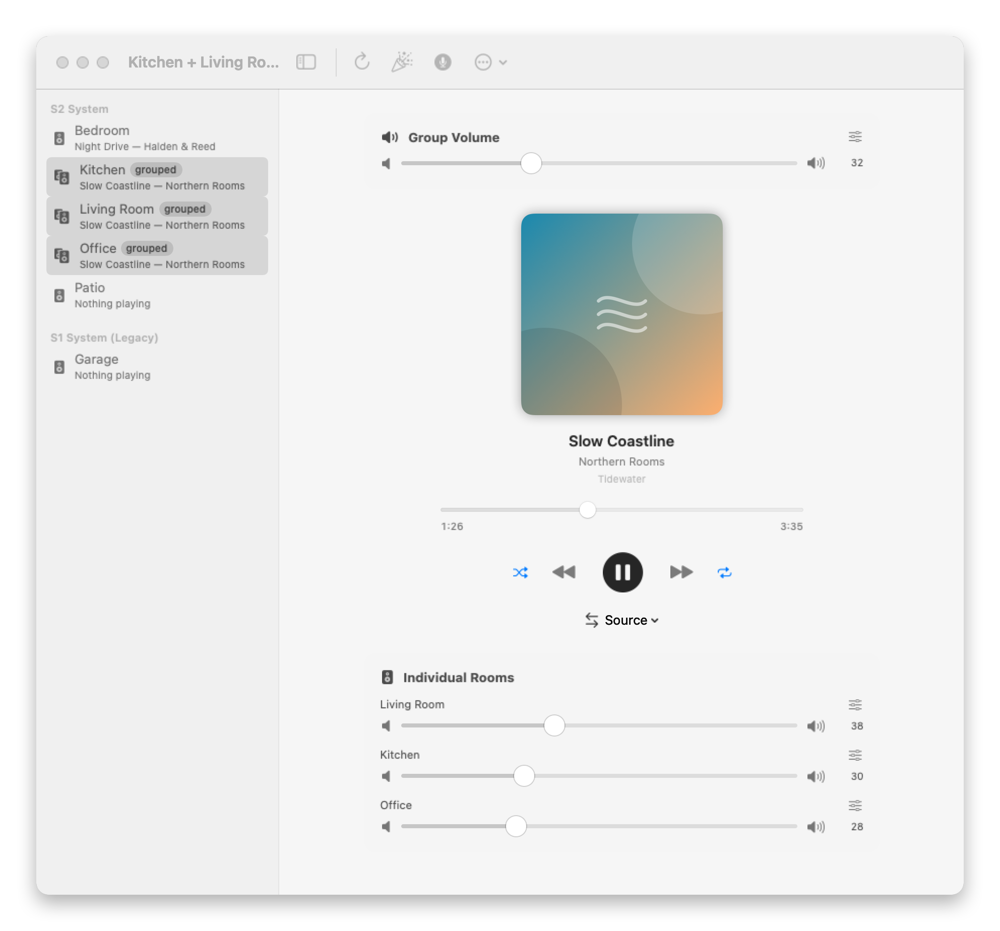
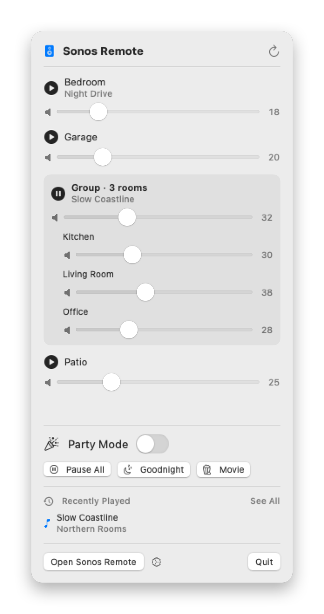
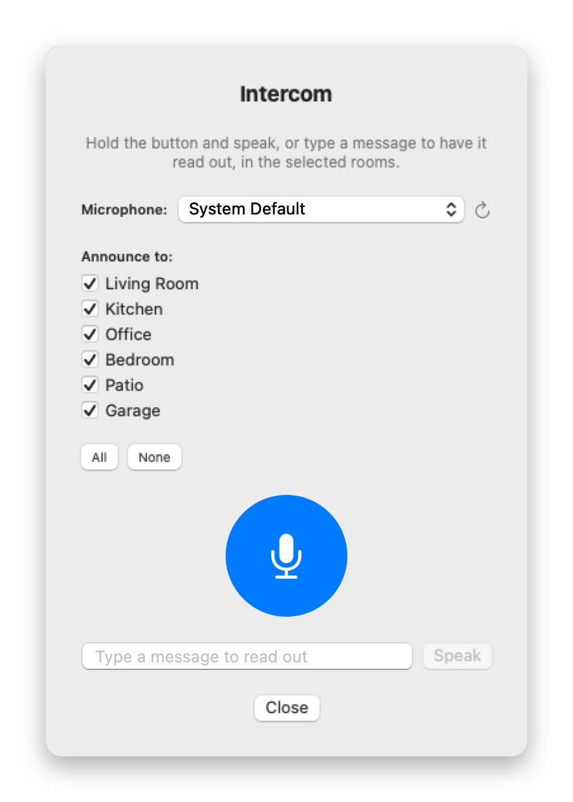
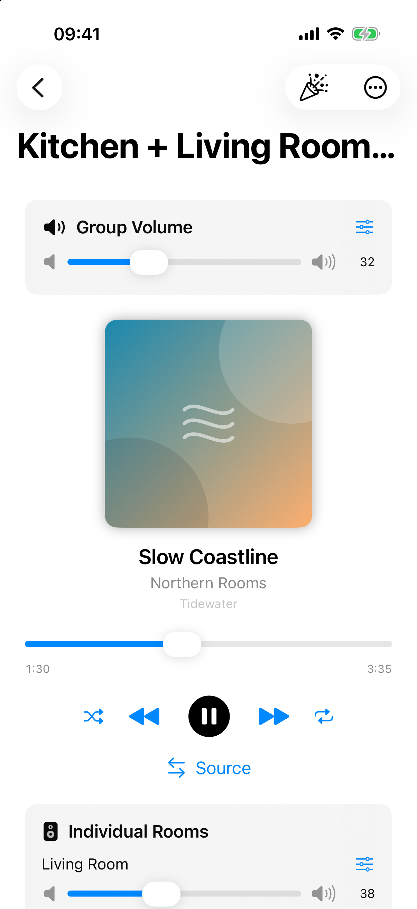
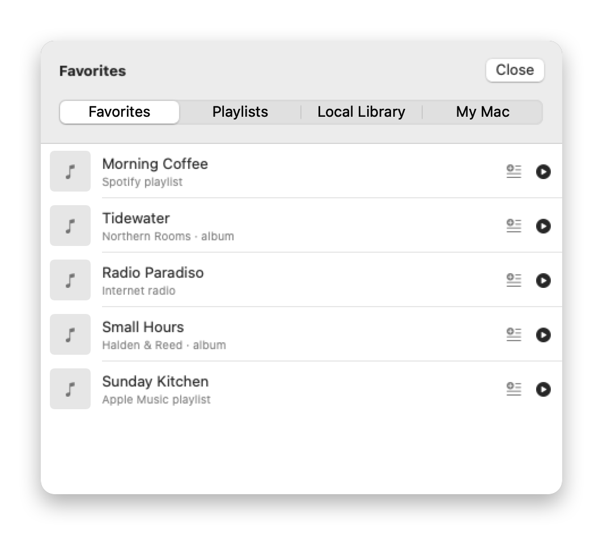
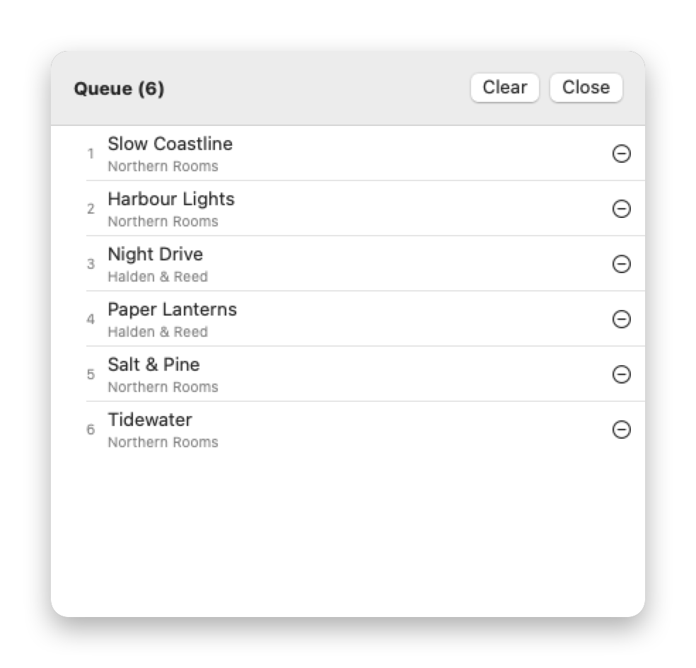
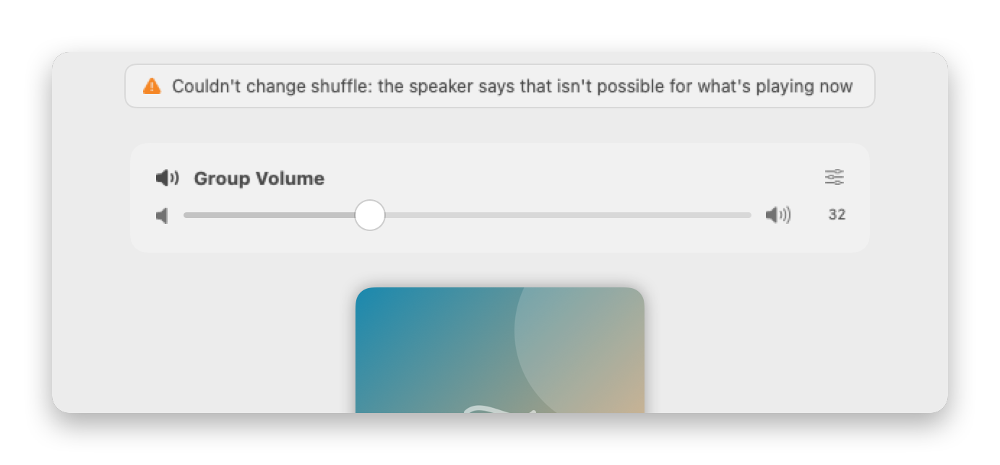

# Sonos Remote

[](https://github.com/nigifabio/sonos-remote/actions/workflows/tests.yml)

A native SwiftUI app for controlling your Sonos system — a Mac app (Apple
Silicon) plus an iOS/iPadOS companion. No cloud, no background server: it
talks directly to your speakers over local UPnP/SOAP on port 1400, the same
protocol Sonos' own apps use, and gets instant state updates via UPnP
eventing (GENA) instead of just polling.

<p align="center">
  <picture>
    <source media="(prefers-color-scheme: dark)" srcset="docs/screenshots/main-dark.png">
    
  </picture>
</p>

| Menu bar tray | Intercom and spoken messages | iPhone |
|:---:|:---:|:---:|
|  |  |  |
| Each group has one slider above its rooms; routines one click away | Hold to talk, or type a message to be read out | The same controls on iOS and iPadOS |

| Library | Queue | When something fails |
|:---:|:---:|:---:|
|  |  |  |
| Favorites, playlists, the Sonos library and a folder on your Mac | Reorder, remove, jump to a track | A plain message instead of nothing happening |

<sub>Screenshots show the built-in demo (sample rooms and tracks, no network): `open -a SonosRemote --args --demo`.</sub>

## Features

- **Auto-discovery** of every room via SSDP + `ZoneGroupTopology`.
- **Live updates via GENA eventing**: play/pause, track, volume, mute,
  shuffle/repeat and **grouping** changes — including ones made from the
  official Sonos app or a physical remote — appear within a fraction of a
  second (grouping measured at about 0.2 s on real speakers). A 30s poll
  remains as a safety net for anything a dropped event would otherwise
  leave stale.
- **Now playing**: album art, title/artist/album, transport controls, a
  seek bar you can drag, and shuffle/repeat. Shuffle and repeat are disabled
  for radio, TV and line-in; when the source keeps its own (a Spotify
  Connect session does), the app says so instead of showing a false "on".
- **TV and line-in inputs**: a Source menu appears for rooms that have one
  (a soundbar's TV input, a speaker's line-in).
- **Favorites, Playlists & local Music Library**: browse everything you've
  already set up in the official Sonos app — including Spotify/Apple Music
  content added as a Favorite or Playlist — and play it with one tap. Sonos
  doesn't let third parties inject an arbitrary streaming service directly
  (that needs their SMAPI partner program), but Favorites/Playlists are just
  more `ContentDirectory` Browse + `AVTransport` Play calls, so this gives
  one-tap access with no OAuth needed on our side.
- **Queue management**: view, reorder (drag), remove, and jump to any track
  in the current play queue; add anything from the Library browser to the
  end of the queue without interrupting what's playing.
- **Local Library ("My Mac", Mac only)**: point Settings ▸ Local Library at
  any folder and its audio files (mp3/m4a/aac/flac/wav/aiff/alac) show up
  under the "My Mac" tab in the Library browser, playable on any room —
  useful for music that was never set up as a Sonos-attached NAS share.
  Files are served over the LAN by the same tiny built-in HTTP server that
  already serves Intercom announcements (`LocalHTTPServer`); Sonos fetches
  them with a normal HTTP GET, the same way it fetches anything else.
- **Alarms & sleep timer**: list/create/enable/delete alarms (ring with the
  built-in Sonos chime), and set a per-room sleep timer.
- **Bass/treble/loudness (EQ)** controls per physical speaker.
- **Party Mode**: one click groups every room together (or splits them back
  apart), household by household — an S1 system next to an S2 one is never
  joined to it — and the group that is already playing keeps playing.
- **Routines**: Pause All, Goodnight (sleep timer on everything playing,
  optionally lowering loud rooms) and Movie Night (the TV room leaves its
  group and switches to TV; optionally sets its volume and pauses the
  rest). Tunable in Settings ▸ Routines; Pause All is also a Shortcut.
- **Per-room pair/unpair**: right-click any room in the sidebar to join it into
  another room's group, or split it back out on its own.
- **Volume sliders**: one general slider per room/group, plus individual sliders
  for each physical speaker when rooms are grouped.
- **Failures are shown**: an action a speaker refuses or doesn't answer puts
  a short plain-language message at the top of the window (or tray) instead
  of silently doing nothing.
- **Intercom** (Mac only): hold a push-to-talk button (with a microphone
  picker if you have more than one input device), speak, release — your
  voice plays as an announcement on the room(s) you pick, then whatever was
  playing there resumes automatically. Sonos has no live-mic-streaming API
  for third-party apps, so this uses record → play-announcement → restore,
  the same pattern Sonos' own voice assistants and doorbell integrations use.
  You can also type a message and have it read out (system voice). Choosing
  a room that leads a group plays to the whole group once, in sync.
- **Shortcuts / Siri support**: play/pause a room, skip, set volume, and
  toggle Party Mode are all exposed as `AppIntent`s with Siri phrases — ask
  Siri or build a Shortcuts automation without opening the app.
- **Menu bar tray** (Mac only): a custom icon in the menu bar opens a compact
  popover: each group with its own volume slider above the rooms in it,
  play/pause, the now-playing track, Party Mode and the routines — without
  opening the main window.
- **Works with other tools on the same Mac** — see "Local control endpoint
  and history file" below.
- **Settings**: light/dark/system appearance, start-at-login, live status for
  every permission the app uses (with one-click links to the right System
  Settings pane), and an About section.
- **Optional live Widget** (Mac only) — see below.

## Platforms

- **Mac** (`SonosRemote` scheme): full feature set, Apple Silicon, macOS 14+.
- **iOS/iPadOS** (`SonosRemoteiOS` scheme): everything above except the menu
  bar tray, the widget, and Intercom (which needs the Mac-only Core Audio
  input-device picker) — that's a documented gap, not a protocol limitation;
  see "Suggested next features" below.

Both targets share `Models`, `Networking`, `Services`, and `ViewModels`
unchanged — none of it depends on AppKit or Core Audio, so the same
discovery/SOAP/GENA code and the same `SonosViewModel` run on both platforms.

## Requirements

- Apple Silicon Mac, macOS 14 (Sonoma) or later, for the Mac app
- iOS/iPadOS 17+ device or simulator, for the companion app
- Xcode 15+
- Same LAN/Wi-Fi as your Sonos speakers
- [xcodegen](https://github.com/yonaskolb/XcodeGen) (`brew install xcodegen`) to (re)generate the `.xcodeproj`
- Works with both **Sonos S2** and **Sonos S1** (legacy) systems — see below

## Build & run

```bash
xcodegen generate
open SonosRemote.xcodeproj
```

Then hit Run in Xcode with the **SonosRemote** (Mac) or **SonosRemoteiOS**
scheme. On first launch, the OS will ask for:
- **Local Network** access (to find and control your Sonos speakers)
- **Microphone** access (Mac only, for the Intercom feature)

Grant both — the app doesn't work without Local Network access. On Mac you
can review and re-open either permission's System Settings pane at any time
from Settings ▸ Permissions.

### Command line

```bash
xcodegen generate
xcodebuild -project SonosRemote.xcodeproj -scheme SonosRemote -configuration Debug build
open "$(find ~/Library/Developer/Xcode/DerivedData -iname 'SonosRemote.app' | head -1)"
```

For iOS, build against the simulator SDK (downloads the iOS platform via
Xcode ▸ Settings ▸ Components the first time, if you haven't already):

```bash
xcodebuild -project SonosRemote.xcodeproj -scheme SonosRemoteiOS \
  -destination 'platform=iOS Simulator,name=iPhone 17 Pro' build
```

### Demo mode

Start either app with `--demo` to look around without a Sonos system: it
shows a sample household (an S2 system with a three-room group, plus an S1
speaker), responds to the controls locally, and never touches the network.

```bash
open -a SonosRemote --args --demo
```

The screenshots at the top of this page are taken from it.

### Tests

```bash
xcodegen generate
xcodebuild -project SonosRemote.xcodeproj -scheme SonosRemoteTests -destination 'platform=macOS,arch=arm64' test
```

215 tests, run on every push by GitHub Actions (`.github/workflows/tests.yml`,
which also builds the iOS app). Covers XML/SOAP/DIDL parsing (including regression tests for two
real bugs — see below), zone-topology parsing against realistic fixtures,
the WAV file builder used by Intercom, GENA event parsing (`LastChange` →
transport state/volume), `SonosViewModel`'s pure logic, the widget's
shared-state JSON encoding, the S1/S2 sidebar split and cross-household
pairing guard, the local-library path-traversal guard, Party Mode per
household, topology merging, play modes, the history file's format, the
control endpoint's request parsing and who-may-call rules, announcement
targeting, and the WAV rebuild used for spoken announcements.

Every `SonosController` function that sends a SOAP action (play/pause,
volume, mute, EQ, alarms, queue management, grouping) also has direct
regression coverage: `SOAPClient` takes an injectable `SOAPTransport`
(defaulting to `URLSession.shared` everywhere in production), and
`FakeSOAPTransport` records each request and returns canned XML — so tests
assert the exact SOAP action/arguments sent and how the response gets
parsed, without touching real hardware. Discovery (SSDP + device
description fetches) isn't part of this — it's covered by
`parseZoneGroups`/`SonosGenerationDetector` tests plus this project's
live-hardware verification passes instead.

## Optional: live Widget (Mac)

`SonosWidget/` is a WidgetKit extension you can add to Notification Center /
the desktop: pick a room per widget instance, see its now-playing track, and
control play/pause, skip, volume, and Party Mode without opening the app.

Widget extensions are **always sandboxed** by Apple, with no exception, and
sharing live data between the sandboxed widget and the unsandboxed main app
requires an **App Group** — which in turn requires the project be signed with
a real Apple ID team (a free personal team is enough, no paid membership
needed). Because of that, the widget target is **not** part of the default
build or a dependency of the main app, so its absence never blocks anything
else in this project.

To enable it:

1. Open `SonosRemote.xcodeproj` in Xcode.
2. Xcode ▸ Settings ▸ Accounts ▸ "+" ▸ add your Apple ID (free tier is fine).
3. Select the **SonosRemote** target ▸ Signing & Capabilities ▸ pick your team.
4. Select the **SonosWidgetExtension** target ▸ Signing & Capabilities ▸ pick
   the same team.
5. On the **SonosRemote** target, add the **App Groups** capability with
   group `group.com.fabionigi.SonosRemote` (Xcode registers it with your
   account automatically); do the same on **SonosWidgetExtension**.
6. Make **SonosRemote** embed **SonosWidgetExtension** (Build Phases ▸ Embed
   Foundation Extensions, or ask this project's assistant to wire the
   `dependencies:`/`embed: true` line back into `project.yml`).
7. Build & run, then add the widget from System Settings ▸ Desktop & Dock (or
   Notification Center, depending on your macOS version) ▸ Edit Widgets.

## Architecture

```
SonosRemote/
  App/            Mac app entry point (main window scene, tray scene, Settings scene)
  Shortcuts/      Siri/Shortcuts AppIntents + AppShortcutsProvider (Mac; do live discovery)
  Models/         SonosDevice, SonosGroup, TrackInfo, BrowseItem, SonosAlarm, AppTheme...
  Networking/     SSDP discovery, raw SOAP client, XML/DIDL parsing
  Services/       SonosController (all Sonos actions incl. Browse/Queue/Alarms/EQ),
                  LocalHTTPServer (serves intercom clips), GENAEventServer +
                  GENASubscriptionManager (UPnP push eventing), IntercomService,
                  AudioDeviceManager (Mac-only: Core Audio input device enumeration)
  Shared/         WidgetSharedState — the App-Group-backed snapshot the main
                  app writes and the widget extension reads
  ViewModels/     SonosViewModel — GENA-driven with a 30s poll fallback
  Views/          SwiftUI screens shared by both platforms (sidebar, now-playing,
                  Library, Queue, Alarms, EQ), plus Mac-only ones (tray, Settings, Intercom)
SonosRemoteiOS/   iOS/iPadOS app entry point + iOS-specific root/settings views
SonosWidget/      Optional Mac WidgetKit extension (see above)
SonosRemoteTests/ Unit tests
```

`SonosController` is a stateless enum of async functions — one call per
Sonos UPnP action (Play, SetVolume, SetAVTransportURI, Browse, ListAlarms,
ConfigureSleepTimer, SetBass, etc.) across AVTransport, RenderingControl,
GroupRenderingControl, ZoneGroupTopology, ContentDirectory, and AlarmClock.
No third-party Sonos library is used; every SOAP envelope and XML/DIDL
response is parsed directly against Sonos' documented local API.

**Favorites/Playlists/Library playback** (`SonosController.play(_:on:)`):
Favorites carry a self-contained, directly playable URI+metadata, so they
just go straight into `SetAVTransportURI` + `Play`. Playlists and local
Music Library containers (albums, artists) are played by replacing the
queue — `RemoveAllTracksFromQueue` + `AddURIToQueue` with the container's
own URI (Sonos expands it into individual tracks) + `SetAVTransportURI`
pointed at the queue — the same mechanism Sonos' own apps use.

**Live updates**: `GENASubscriptionManager` SUBSCRIBEs to each group
coordinator's AVTransport/RenderingControl event URLs with a CALLBACK
pointing at `GENAEventServer` (a tiny local HTTP server), renews before the
5-minute timeout, and parses each NOTIFY's `LastChange` payload into a plain
transport-state or volume change that `SonosViewModel` applies immediately.

**Intercom flow** (Mac only): record from the chosen mic via `AVAudioEngine`
→ convert to 16-bit/44.1kHz mono PCM → build a WAV file by hand (see
"Notable bugs fixed" below) → served over `LocalHTTPServer` (port 57123) →
each target room's current track/position/URI is snapshotted → the clip
plays via `SetAVTransportURI` + `Play` → once it finishes, the room's
previous state is restored.

## Local control endpoint and history file

Two small things let other programs on the same Mac build on the running
app. Both exist for the [Sonos MCP server](https://github.com/nigifabio/sonos-mcp-server)
(`announce` and `get_play_history`), but nothing about them is specific to it.

**History file.** Sonos keeps no play history, so the app records what it
sees playing (last 200 tracks) and mirrors it to
`~/Library/Application Support/SonosRemote/history.json`:

```json
{ "version": 1, "updated": "2026-10-12T16:00:00Z",
  "entries": [ { "played_at": "2026-10-12T15:59:44Z", "room": "Office",
                 "title": "…", "artist": "…", "album": "…", "service": "Spotify",
                 "source": "Favorite or playlist name, when known",
                 "uri": "x-sonos-spotify:…" } ] }
```

Newest first. Only what played while the app was running is in it.

**Control endpoint** on port 57123, the same listener that serves audio to
the speakers:

| Request | Body | Result |
|---|---|---|
| `GET /api/status` | — | `{"ok": true, "version": "1.3", "rooms": ["Office", …]}` |
| `POST /api/announce` | `{"text": "…", "rooms": ["Office"], "volume": 20, "voice": "Alice"}` (only `text` is required) | Speaks the text, restores what was playing, returns the rooms that heard it |

```bash
curl -s http://127.0.0.1:57123/api/announce -H 'Content-Type: application/json' \
     -d '{"text": "Dinner is ready", "rooms": ["Kitchen"]}'
```

`/api/...` is only answered for connections from this Mac. Because a web
page open in a browser is also "this Mac", requests a browser could send
cross-site are refused too: anything with an `Origin` header, and any POST
not declared as JSON. The audio and library paths stay reachable from the
LAN, since the speakers have to fetch them.

## Notable bugs fixed along the way

- **`upnp:album` matching inside `upnp:albumArtURI`**: the tag-extraction
  regex lacked a word boundary after the tag name, so a track's album field
  came back corrupted with the album art URL and surrounding XML. Fixed by
  anchoring with `\b`; covered by a regression test.
- **Main (group) volume slider showing the wrong number and snapping
  back**: two causes, both reproduced on real speakers. The live-event
  handler wrote the *coordinator's own* volume into the group slider, so in
  a multi-room group it was wrong from launch (coordinator at 34, group
  actually 38) and jumped away right after a drag (set 43, snapped to 39).
  And `SetGroupVolume` was sent without the `SnapshotGroupVolume` Sonos
  expects first, so members were scaled from stale ratios: a room that had
  been adjusted on its own went *down* (34 → 31) while the group went up.
  Fixed by snapshotting first, taking group volume from
  GroupRenderingControl events, subscribing to every room's own volume, and
  having the slider hold its own value during a drag.
- **Intercom crash (`EXC_BREAKPOINT` in Core Audio)**: writing an already-
  converted Int16 PCM buffer into an `AVAudioFile` opened with Int16 settings
  crashed, because `AVAudioFile.write(from:)` requires the buffer to match
  the file's *processing* format, which for PCM is always float32 regardless
  of the on-disk settings requested. Fixed by building the WAV file by hand
  (RIFF header + raw PCM bytes) instead of going through `AVAudioFile` at all.
- **Accidental deletion of `SOAPClient`**: an edit meant to add two new
  `SonosService` cases briefly overwrote the whole file, dropping the actual
  `SOAPClient.call` implementation. Caught immediately by a standalone
  compile check before it reached the app — a reminder to always rebuild
  after editing a file that's this central.

## Sonos S1 (legacy) compatibility

Sonos splits its ecosystem into **S2** (current) and **S1** (older hardware
that never upgraded). This app talks only to the local UPnP services that
have been part of Sonos' local control API since long before that split —
`AVTransport`, `RenderingControl`, `GroupRenderingControl`,
`ZoneGroupTopology`, `ContentDirectory`, and `AlarmClock` — so it should work
against an S1 household without any protocol-level changes. Concretely:

- `parseZoneGroups` filters out `IsZoneBridge="1"` members, not just
  `Invisible="1"` ones — a **Sonos Bridge** (needed on many original SonosNet
  setups, common in S1-era systems) shows up in topology but has no
  transport/rendering services, so it must never be treated as a room.
- Every SOAP call site already degrades gracefully (`try?`, default values)
  rather than crashing if an older device lacks a particular action.
- `GENASubscriptionManager` now reads back the GENA `TIMEOUT` header a
  device actually grants instead of assuming our requested 300s was
  honored, and schedules renewal off that real value. Older/embedded
  firmware is more likely to grant a shorter subscription than a current
  S2 speaker — assuming 300s regardless would let the subscription lapse
  silently, with no symptom beyond live updates quietly reverting to the
  30s poll.
- **Multi-household discovery.** S1 and S2 devices can never join the same
  Sonos household, but they *can* coexist on the same physical network as
  two separate households that are invisible to each other (each one's
  `ZoneGroupTopology` only ever reports its own members). `discoverGroups()`
  now runs `ZoneGroupTopology.GetZoneGroupState` against every host SSDP
  finds, not just the first one, and merges in any group whose members
  haven't already been seen — so a second, S1-only household shows up
  alongside the main S2 one instead of being silently dropped.
- Each device's generation is detected via `device_description.xml`
  (`SonosGenerationDetector`): a small set of legacy-only model numbers
  (ZP80/90/100/120, CR100) are hardcoded as S1, and everything else falls
  back to the `displayVersion` major version (S1 firmware tops out around
  11.x; S2 starts at 12). The sidebar (`SidebarView`) splits into
  "S2 System" / "S1 System (Legacy)" sections automatically the moment a
  mixed network is detected, and the pair/unpair menu no longer offers
  pairing a room into a group from the other household (Sonos has no
  concept of a cross-household group, so that action would just fail).

**Verified against real S1 hardware.** Building the multi-household
discovery above immediately surfaced a genuine S1 device already sitting
on the test network — a Sonos Play:5 (`amelia Room`, model `S5`, firmware
`11.16.1`) that every previous version of this app had been completely
blind to. A full read-only pass against it, using the exact same
unmodified protocol code paths used for S2 devices, came back clean:
volume (`GetVolume`), transport state (`GetTransportInfo`), track info
(`GetPositionInfo`), mute (`GetMute`), bass/treble (`RenderingControl` EQ
actions), `ContentDirectory` Browse (Favorites), `AlarmClock.ListAlarms`,
and a full GENA `SUBSCRIBE` cycle all succeeded with zero errors. The GENA
`TIMEOUT` this particular S1 firmware grants is `Second-300` — the same
as S2 — so the defensive real-timeout-parsing fix above wasn't strictly
necessary for this device, but stays in place since other S1 firmware
versions could differ.

## Known limitations

- An announcement to a room that leads a group is heard by the whole group
  (whatever a coordinator plays, its group plays). Only a room that follows
  can be singled out.
- Shuffle/repeat can't be changed for sources that keep their own, such as
  a Spotify Connect session; change those in the app the music comes from.
- The app is ad-hoc signed ("Sign to Run Locally") — fine for building and
  running on your own devices, but Gatekeeper will warn on a Mac that didn't
  build it (right-click ▸ Open bypasses this once), and the iOS app can only
  run on devices you've registered for local development.
- A speaker that is switched off is noticed missing at the next 30s poll;
  one that is switched on is found at the next rescan (every 5 minutes, or
  the Refresh button).

## Suggested next features

- **Intercom on iOS**: needs an iOS-appropriate input picker (iOS doesn't
  have Core Audio's HAL device model — it's `AVAudioSession` route picking
  instead), so this is a real platform difference, not just missing UI.
- **Announcements that don't interrupt**: Sonos S2 has an audio-clip API
  that plays a clip over the music in a single room, even inside a group.
  It would lift the "coordinator means whole group" limitation above.
- **Drag-and-drop room grouping UI**, as an alternative to the context menu.
- **watchOS complication / CarPlay** for the most common controls.
- **Notarized, signed distribution** (currently ad-hoc only) — needs a paid
  Apple Developer Program membership to notarize the `.pkg` for Gatekeeper.
